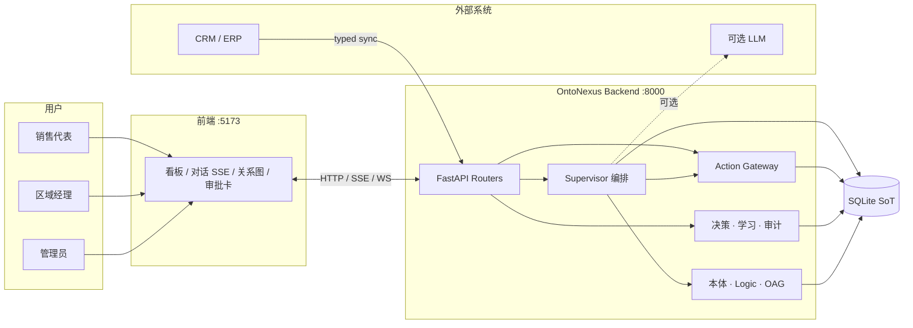
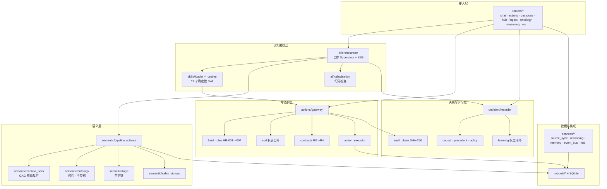
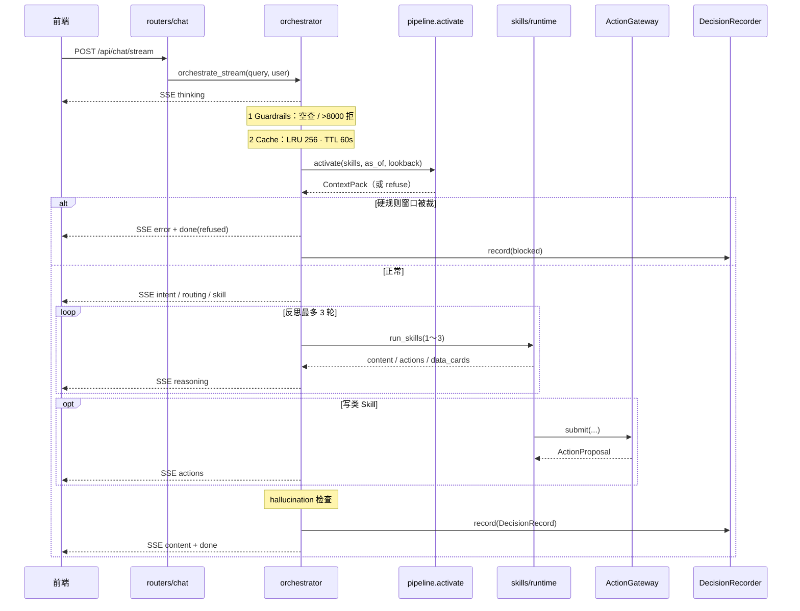
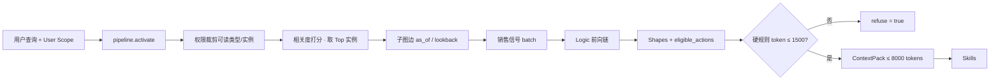
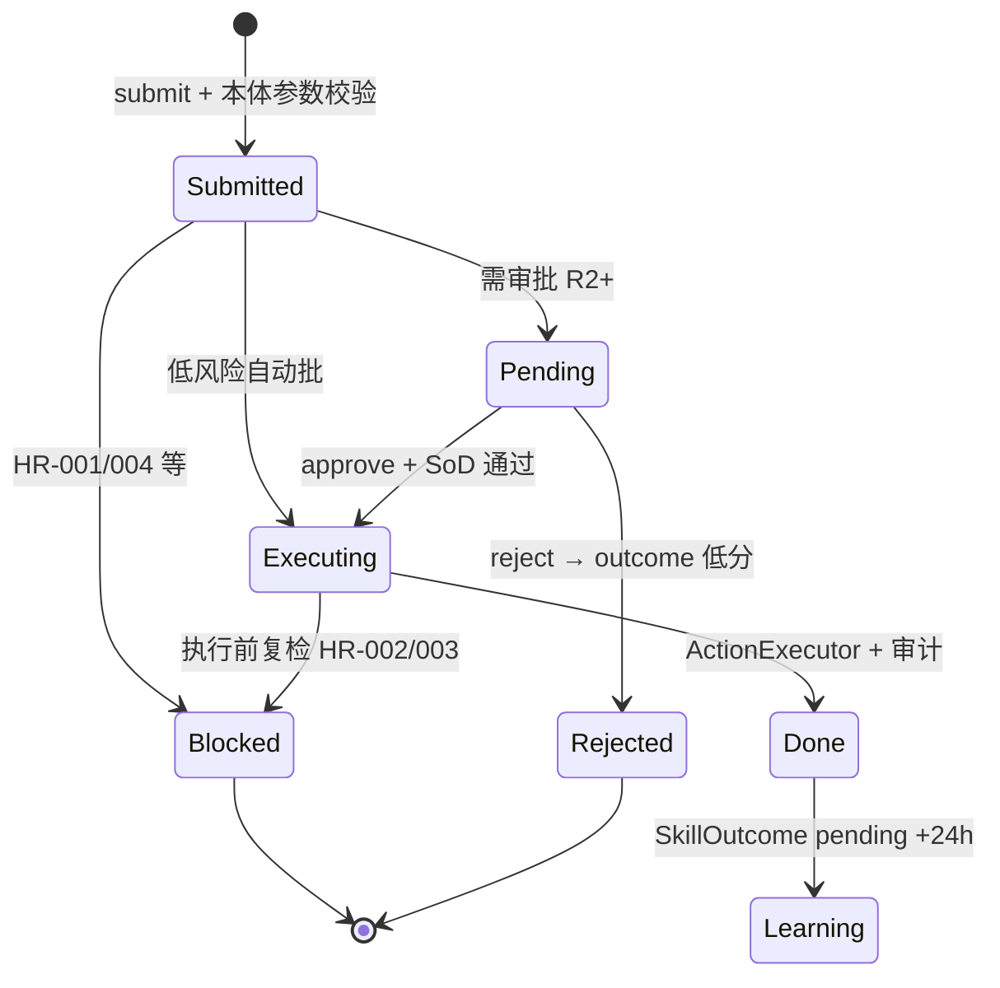
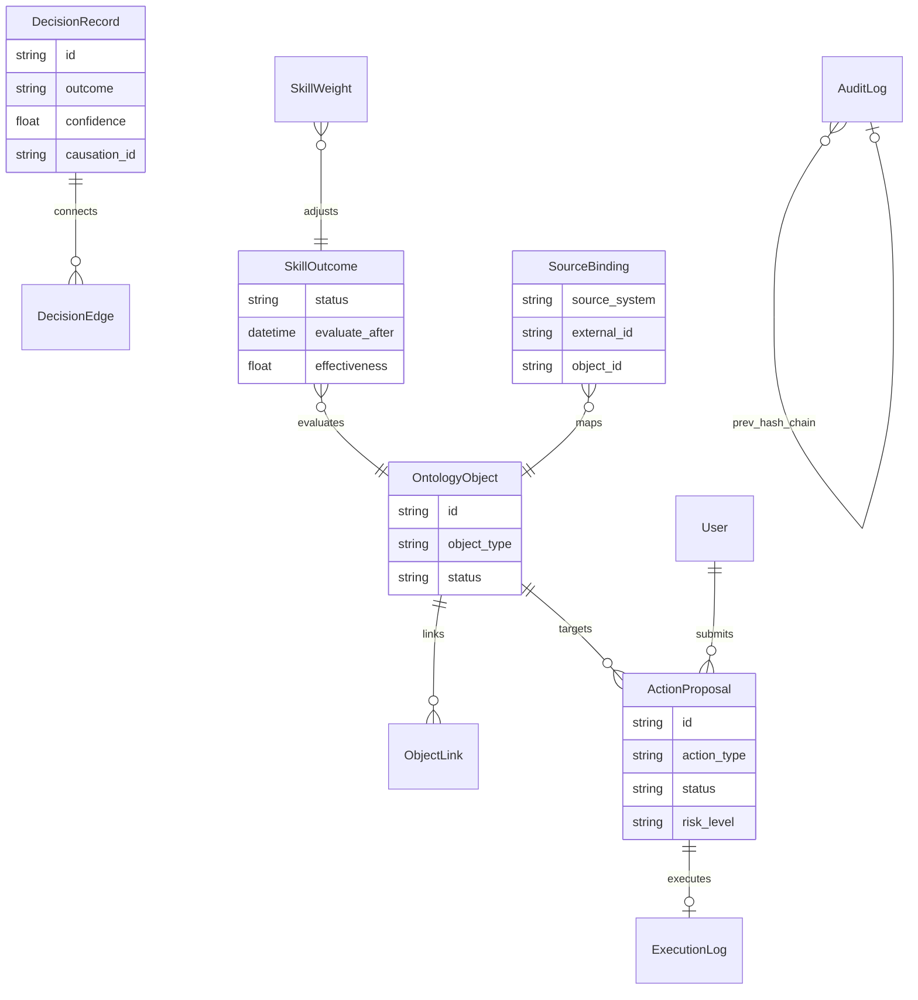

# OntoNexus 设计文档

本文描述 OntoNexus 的产品目标、系统架构与**后端核心能力**。实现分层摘要见 [ARCHITECTURE.md](./ARCHITECTURE.md)；快速上手见 [README.md](../README.md)。

---

## 1. 产品定位

OntoNexus 是面向医药销售的 **AI 决策中枢**：把 ERP/CRM 事实组织成本体，经 Supervisor + OAG + Skill 完成「看清 → 拍板 → 落库 → 复盘」。

| 维度 | 设计选择 |
|------|----------|
| 数据主权 | 不承担业务录入；事实由 ERP/CRM 同步进入本体 |
| 对话 | **OAG**（Ontology-Augmented Generation）：本体实例 / 关系 / 硬规则 / Logic 推导 / 销售信号进上下文，而非纯文档 RAG |
| 写操作 | **唯一写入口** Action Gateway：硬规则 + 职责分离 + 审批后落库 |
| 闭环 | 建议/审批后默认 **24h** 用销售信号评估，回写 Skill 路由权重 |
| 运行时 | 主编排路径为**确定性 Skill**；LLM 可选，未配置仍可服务 |

**非目标**：培训台、报销套件、电商平台；完整 OWL/SPARQL、湖仓连接器、NER；绕过 Gateway 的快捷写库。

---

## 2. 架构总览

### 2.1 系统上下文



### 2.2 后端分层



### 2.3 部署与流量

| 组件 | 默认 |
|------|------|
| Backend | `uvicorn main:app` → `:8000` |
| Frontend | Vite → `:5173`，`/api` 代理到 8000 |
| 持久化 | `backend/ontonexus.db`（SQLite SoT） |
| 实时 | `WS /api/ws/{user_id}`；风险扫描约 300s 广播 |
| 后台 | 学习评估约 60s；启动时 seed + 嵌入模型预加载 |

---

## 3. 设计原则

1. **本体即契约** — 类 / 属性 / domain-range / `applies_to` 校验失败即拒绝  
2. **单一写入口** — 世界状态变更只经 Gateway；Logic 推导不回写 SQLite  
3. **读宽写严** — 分析可深查；R2+ 须审批且提交人 ≠ 终审人  
4. **硬规则不可裁** — OAG 为硬规则保留 token 窗口，被裁则**拒答**而非降级胡说  
5. **可追溯** — DecisionRecord + 因果边 + ExecutionLog + 审计哈希链  
6. **可学习、不改写事实** — 学习只调 Skill 路由权重  
7. **显式映射** — ingest 要求 `(source_system, external_id)`，不做 NER  

---

## 4. 后端核心能力

后端不是「套一层 LLM 的 CRUD」，而是：**语义内核 + 编排引擎 + 写边界 + 决策学习闭环**。主编排路径默认走确定性 Skill，保证可测、可审计、可离线演示。

### 4.1 Supervisor 七步编排

入口：`POST /api/chat/stream` → `ai/orchestrator.orchestrate_stream`。



| 步骤 | 行为要点 |
|------|----------|
| Guardrails | 空查询拒绝；`len(query) > 8000` 拒绝 |
| Cache | key=`user_id:pinned:query`；最多 256 条；TTL 60s；`OrderedDict` LRU |
| Intent | `SkillLoader.match` / `match_many(limit=3)`；分数乘学习权重 |
| Slot | `extract_slots`：object_id、action_type、causation_id、parent_decision_id 等 |
| Agent+Skill | 单一 DecisionAgent；`run_skills` 合并 1～3 个 Skill 输出 |
| Reflection | 最多 3 轮，直到 `status==ok` 且内容非空 |
| Hallucination | `detect_hallucination`；通过置信约 0.85，失败约 0.55 并附警告 |
| Persist | `DecisionRecorder.record`；可选因果边 `precedes` |

**SSE 事件目录**：`thinking` · `intent` · `routing` · `skill` · `reasoning` · `tools_used` · `actions` · `data_card` · `follow_ups` · `suggestions` · `content` · `error` · `done`（含 `decision_id`、`reasoning_trace`、`refused`、`cached` 等）。

### 4.2 Skill 体系

| Skill | 职责 | 是否走 Gateway |
|-------|------|----------------|
| `ontology_lookup` | 按名/类型查对象、关系、可用动作 | 否 |
| `metric_diagnosis` | 达成率/处方量等阈值诊断；可懒加载 L3 `references/` | 否 |
| `causal_explainer` | 关系/决策边渲染为因果链 | 否 |
| `attribution-analyzer` | 覆盖率 / 拜访效果 / KOL / ROI / 产品归因排序 | 否 |
| `what-if-simulator` | 情景参数重算与风险档位 | 否 |
| `decision-penetrate` | 指标 → 医院 → 医生 → 代表穿透 | 否 |
| `report_narrator` | 已核实分析排版为报告草稿 | 否 |
| `alert-manager` | 扫描 warning/critical 对象清单 | 否 |
| `recommend-and-accept` | 建议动作；用户接受后才 submit | 是（接受后） |
| `recovery_plan_drafter` | 起草复苏计划提案 | 是 |
| `action_operator` | 用户明确要求执行/审批时提交写动作 | 是 |

**加载与匹配**（`skills/loader.py`）：

- 扫描 `skills/*/SKILL.md` frontmatter（intent、triggers、risk、depends_on、plan_steps…）  
- 评分：`hits × trigger_weight × learn_weight`  
- `depends_on` 拓扑展开，最大深度 **5**，最终 cap **3** 个 Skill  
- L3：`references/*.md` **仅执行时**加载（如 `metric_diagnosis/references/THRESHOLDS.md`：warn 80% / critical 60%）  

**运行时**（`skills/runtime.py`）：全部映射到 Python handler；主编排**不依赖 LLM**。分析类 Skill 禁止下发写动作卡。

### 4.3 OAG Pack：语义上下文工程



| 常量 | 值 | 含义 |
|------|-----|------|
| 总预算 | 8000 tokens | `estimate_tokens ≈ len/3` |
| 硬规则窗口 | 1500 | 放不下则 `truncated_hard_rules` → 拒答 |
| Schema 切片 | 剩余的约 1/4 | 允许的类/关系 |
| 实例上限 | Top 16 | 相关度排序后裁剪 |
| 子图边 | ≤ 12 | `as_of` 默认 now |
| activate 缓存 | TTL 30s | 按 user/query/skills/as_of 键控 |

**相关度信号**（`relevance_score`）：精确名命中 +6；名 token 重叠 +2；类型命中 +2；Skill 偏好类型 +3；warning/critical +1.5。

**销售信号**（`semantic/sales_signals.py`，batch 预取 chunk≈400）：

| 信号 | 要点 |
|------|------|
| `coverage` | 覆盖医生数 / 总数 |
| `kol` | `INFLUENCES` 链与影响分 |
| `roi` | ExpenseROI 费用与产出比 |
| `visit_effect` | 拜访前后处方序列 delta |
| `quota` | 目标 / 实际 / 预测 / 达成率 / 缺口 |

### 4.4 Logic 前向链

`semantic/logic.py`：`forward_chain` 至不动点，最多 **20** 轮。

| 规则族 | 示例 |
|--------|------|
| 子类 | `Doctor(?x) ⊢ HCP(?x)` |
| 风险 | `Status(warning|critical) ⊢ AtRisk` |
| 随访 | `AtRisk ∧ HCP ⊢ NeedsFollowUp` |
| 传递 | `INFLUENCES(a,b) ∧ INFLUENCES(b,c) ⊢ INFLUENCES(a,c)`（禁自环） |

输出：`facts` / `derived` / `trace`（结论 ← 规则 ← 前提）。推导进 OAG pack，**不落库**。

### 4.5 Action Gateway：写世界的唯一闸门



| 规则 | 含义 |
|------|------|
| HR-001 | 无 `object_id` 不得提案写操作 |
| HR-002 | R2+ 未审批不得执行 |
| HR-003 | 提交人 ≠ 终审人（`sod.check_sod`） |
| HR-004 | `applies_to` 须匹配对象类（含子类） |

**契约**（`actions/contracts.py`）：动作绑定风险 R0–R4、`requires_approval`、`applies_to` 类列表。未知动作默认按 R2 需审批。

**执行**（`action_executor.py`）：禁止绕过 Gateway（须 `_via_gateway=True`）；校验前置条件与副作用；写 `ObjectEvent` / `ExecutionLog`；`append_audit`。

**审批体验**：`POST /api/actions/{id}/approve` → 批准后**自动** `execute_approved`，前端无需二次点执行。

### 4.6 决策、政策、先例与因果

| 模块 | 能力 |
|------|------|
| `DecisionRecorder` | 落 `DecisionRecord`：category、outcome、confidence、evidence、policy 结果、`reasoning_trace`、latency 等 |
| `PolicyEngine` | 如 `min_confidence≥0.5`、outcome 白名单；不通过则强制 `blocked` |
| `causal` | 边类型 `triggers` / `enables` / `causes` / `precedes`；BFS 追溯祖先/后代链 |
| `precedent` | 近 200 条决策词法重叠 + 记忆语义检索兜底 |
| `event_bus` | 决策/策略/动作等事件；按 `causation_id` 关联因果链 |

### 4.7 学习闭环

```mermaid
flowchart TB
  A[接受 / 批准动作] --> B[SkillOutcome pending]
  B --> C["evaluate_after = now + 24h\n可配 SKILL_EVALUATE_AFTER_HOURS"]
  C --> D[后台每 60s evaluate_due_outcomes]
  D --> E[score_from_signals]
  E --> F{effectiveness}
  F -->||< 0.3| G["weight = max(0.3, w - 0.2)"]
  F -->|> 0.7| H["weight = min(1.5, w + 0.1)"]
  F -->|中间| I[保持 / 记 last_score]
  G --> J[下次 Intent 匹配乘 learn_weight]
  H --> J
  I --> J
```

信号打分示例：拜访效果上升 → 0.85；覆盖率 ≥60 → 0.75；ROI≥1 → 0.80；仍 warning/critical → 0.25。拒绝提案可立即记低分（如 0.2）。

权重区间 **[0.3, 1.5]**，默认 1.0；只影响路由，不改业务事实。

### 4.8 CRM/ERP 同步

`POST /api/ingest/sync` → `source_sync.sync_batch_isolated`：

1. 校验 `source` / `external_id` / `object_type` / `name`  
2. 类存在 + `require_valid_object`  
3. 解析 link（`target_id` 或经 Binding 的 `target_external_id`）+ `require_valid_link`  
4. 每条 **SAVEPOINT** 隔离；单条失败不影响其余  
5. upsert 实例与领域行；维护 `SourceBinding`  

不做 NER，不编造身份；类型绑定后不可随意漂移。

### 4.9 审计哈希链

```
record_hash = SHA256(prev_hash ‖ canonical(action, entity, user, details, …))
```

创世 `prev_hash` 为 64 个零。Gateway 的 submit / approve / execute / blocked 均追加。`GET /api/audit/verify-chain` 全链重算校验。

### 4.10 其它后端能力面

| 能力 | 路径 | 要点 |
|------|------|------|
| 深度推理 API | `services/reasoning_service.py` | 一致性校验、因果 BFS、时序、隐式关系、多方法归因（含 Shapley/回归等） |
| 感知回写 | `routers/perception.py` | 处方趋势、拜访间隔、风险分；可回写 `OntologyObject.status` |
| 情景重算 | `scenario_service` | 参数调整 → 预测与 on_track/at_risk/critical |
| Hub 聚合 | `routers/hub.py` | 待批拆分、预警、权重、学习到期、Logic 快照、绑定统计 |
| 记忆 | `memory_service` | FTS5 + 768 维向量 KNN；决策先例语义检索 |
| 事件总线 | `event_bus` | 内存环 + 持久化；`correlate(causation_id)` |
| 推理规则 API | `/api/inference` | 规则列表与执行；置信融合 |
| 本体管理 | ontology-admin | 变更请求 / 版本等运维面 |

### 4.11 后台任务（`main.py` lifespan）

| 任务 | 周期 | 作用 |
|------|------|------|
| `periodic_risk_scan` | ~300s | warning/critical 计数 → WS 广播 |
| `periodic_learning_eval` | ~60s | 到期 SkillOutcome 打分并调权 |
| seed + 嵌入预加载 | 启动一次 | 演示数据与记忆检索就绪 |

---

## 5. 前端信息架构

| 分组 | 页面 | 背后主要后端能力 |
|------|------|------------------|
| 拍板 | 今日战情 / 谁需要盯 / 待你拍板 / 问一句 | Hub overview、销售信号、Gateway、SSE 编排 |
| 闭环 | 核对 / 拦住 / 已改 / 看效果 | 校验快照、blocked 决策、ExecutionLog、SkillOutcome |
| 弄清原因 | 原因说明 / 先算一算 | attribution、scenario recalc |
| 关系 | 关系图 | 本体图投影（只读） |
| 系统 | 系统校验（admin） | Hub logic、规则与快照 |

技术栈：React 18 + TS + Vite + Tailwind + TanStack Query；对话走 SSE；图布局可用 Web Worker。

---

## 6. 数据模型（SoT）

权威库：SQLite `ontonexus.db`。



另有：领域业务表（`domain_mapper`）、聊天线程、`ObjectPermission`、记忆/向量表（与 SoT 分离）。

---

## 7. 关键 API 面

| 域 | 代表端点 |
|----|----------|
| 对话 | `POST /api/chat`、`/chat/stream`、`/stream/chat` |
| 动作 | `POST /api/actions/{id}/approve`（自动执行） |
| 决策 | `GET /api/decisions/{id}`、`/chain`、`/search`；`/learning/*` |
| Hub | `GET /api/hub/overview`、`/logic`；`POST /hub/run` |
| 同步 | `POST /api/ingest/sync`；`GET /bindings` |
| 本体 | snapshot validate；对象 CRUD；definition |
| 推理 | `/api/reasoning/*`、`/api/inference/*`、`/api/scenarios/*` |
| 审计 | `GET /api/audit/verify-chain` |
| 实时 | `WS /api/ws/{user_id}` |

OpenAPI：`http://localhost:8000/docs`。

---

## 8. 安全与权限

- JWT Bearer（`auth.py`）；`SECRET_KEY` 生产必须替换  
- 角色矩阵 + `ObjectPermission` 对象级覆盖  
- 敏感字段按类型脱敏（非 admin）  
- OAG 按 `AccessScope` 裁剪可读类型  
- Gateway 再拦一层 HR + SoD（与前端角色校验叠加）  

---

## 9. 质量与可验证性

后端测试主题（`backend/tests/`）覆盖：编排与拒答、Gateway/SoD、语义 pipeline 与前向链、Skill 合并与 L3、学习与 depends_on、决策/政策/先例、销售信号、ingest savepoint、Hub 聚合、本体 TBox、审计链等。

这意味着：**编排拒答、写闸门、语义推导、学习调权**均可自动化回归，而不是「只靠 prompt 自觉」。

---

## 10. 典型端到端场景

**A. 代表提案 → 经理批准 → 24h 复盘**  
问一句 → 写 Skill → Gateway pending → 经理 approve 自动执行 → SkillOutcome → 定时评分 → 权重变化影响后续 Intent。

**B. 只分析不写**  
归因 / What-if / 预警 → 仅 `data_card` → DecisionRecord；无写动作卡。

**C. 源系统灌数**  
typed sync → 校验 → Binding upsert；非法单条拒绝。

---

## 11. 文档与代码索引

| 位置 | 内容 |
|------|------|
| [ARCHITECTURE.md](./ARCHITECTURE.md) | 分层与边界短文 |
| `backend/ai/orchestrator.py` | Supervisor + SSE |
| `backend/skills/` | SKILL.md + runtime handlers |
| `backend/semantic/` | 本体、Logic、OAG、销售信号 |
| `backend/actions/` | Gateway、硬规则、SoD、契约 |
| `backend/decision/` | 记录、因果、政策、学习 |
| `backend/services/` | 同步、审计、推理、记忆、Hub 支撑 |
| `frontend/src/App.tsx` / `Layout.tsx` | 页面与导航 |

---

## 12. 演进方向（建议，非承诺）

1. 生产身份（SSO、密钥轮换、审计导出）  
2. 效果评估对照基线（区域/品类）  
3. 声明式源映射 DSL（仍显式 ID，不做 NER）  
4. 快照违规的可操作修复流  

---

*与代码同步维护；冲突时以代码与 ARCHITECTURE 为准并回写本文。*
